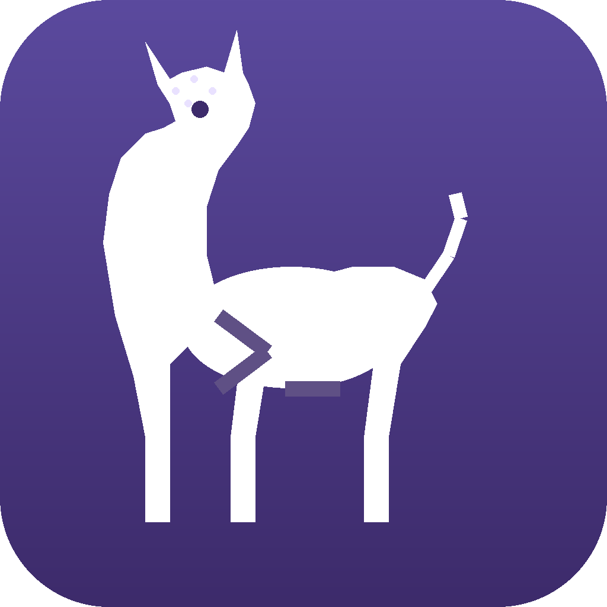
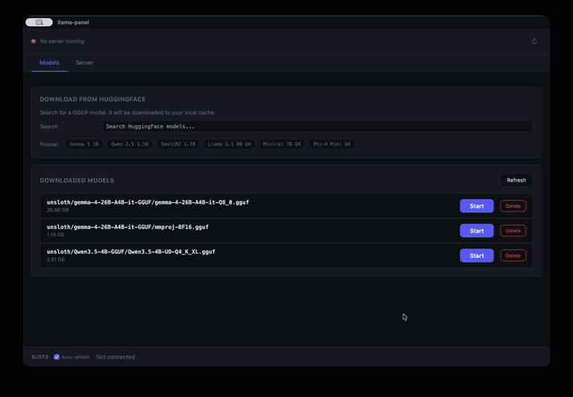
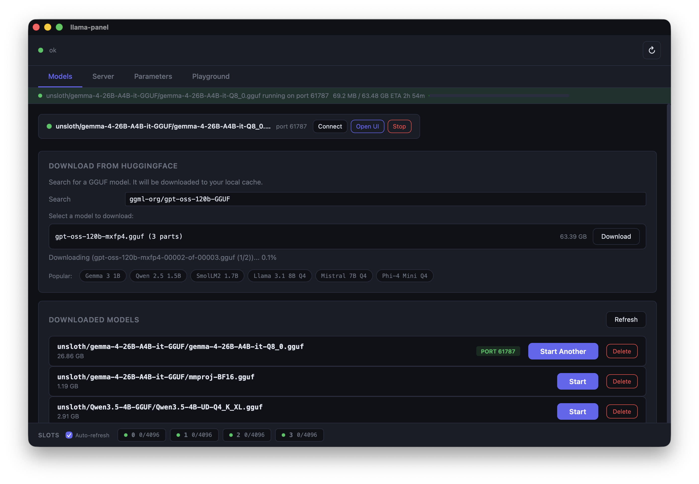
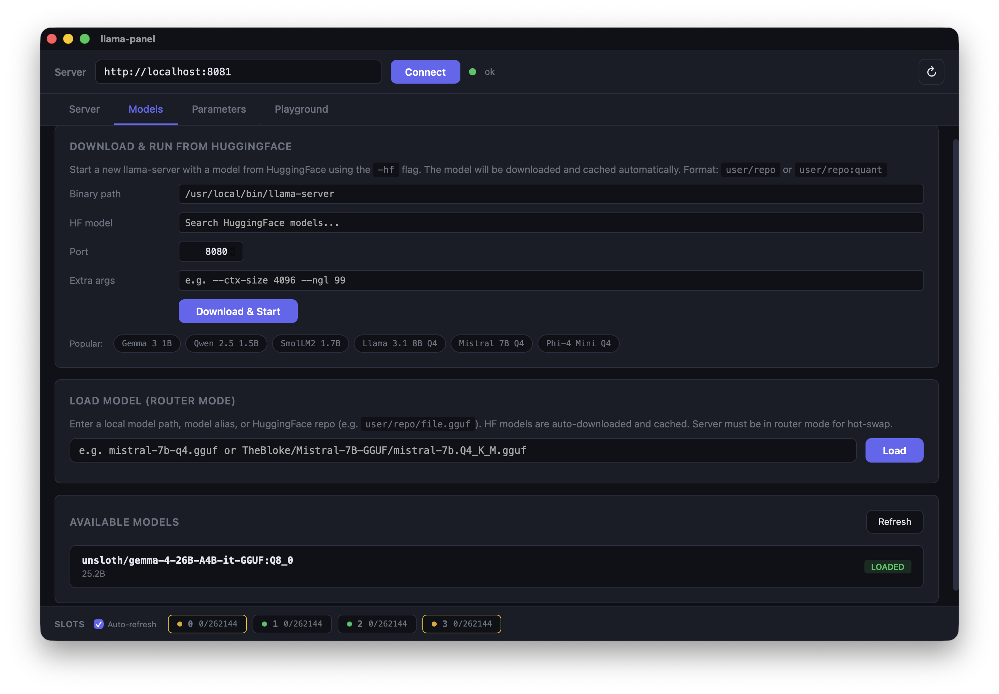
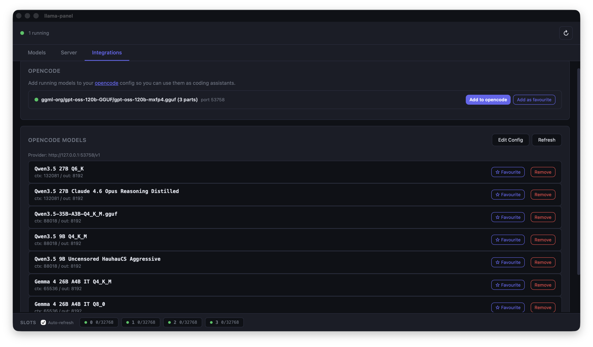

<p align="center">
  
</p>

<h1 align="center">llama-panel</h1>

<p align="center">
  A native desktop app for macOS and Linux that manages and interacts with <a href="https://github.com/ggerganov/llama.cpp/tree/master/examples/server">llama-server</a> instances. Built with <a href="https://tauri.app/">Tauri</a>.
</p>

<p align="center">
  
</p>

## Features

- **Download models from HuggingFace** -- live search, automatic split-file handling, download progress with ETA
- **Run multiple servers simultaneously** -- each model gets its own random port, manage them all from one place
- **Auto-detects llama-server** -- finds the binary on your PATH or common install locations
- **Downloads to the standard HuggingFace cache** (`~/.cache/huggingface/hub/`) -- shared with `huggingface-cli`, LM Studio, and other tools
- **Multimodal aware** -- `mmproj` projector files are recognised as companions rather than separate models and passed to llama-server via `--mmproj`
- **Respects llama.cpp model-source env vars** -- see [Model locations](#model-locations)
- **Open llama-server's built-in web UI** in your browser with one click
- **Configure server options** -- context size, GPU layers, flash attention, parallel slots, and more
- **Tune parameters** with interactive sliders and presets (Creative, Balanced, Precise, Deterministic)
- **Playground** for completions and chat with performance metrics
- **Live server log** -- see model loading progress, layer offloading, and errors in real time
- **Slot monitor** with real-time polling

## Model Management

Search HuggingFace for GGUF models, download them, and start serving with a few clicks. Split models (multi-file GGUFs) are detected and downloaded as a bundle automatically.

<p align="center">
  
</p>

- **Live search** -- type to search HuggingFace for GGUF models, see download counts and likes
- **Smart file picker** -- shows available quantizations with file sizes, groups split models into bundles
- **Download progress** -- real-time progress bar with ETA, visible from any tab
- **Popular model suggestions** -- quick-pick chips for Gemma, Qwen, Llama, Mistral, Phi, and more
- **Multiple servers** -- run several models at once, each on its own port. Connect, open in browser, or stop individually

## Model locations

By default llama-panel reads and writes the standard HuggingFace hub cache at `~/.cache/huggingface/hub/`. The following environment variables (the same ones llama.cpp honours) override or extend where it looks for models:

| Variable | Effect |
| --- | --- |
| `HF_HUB_CACHE` | Use this directory as the HuggingFace hub cache. |
| `HF_HOME` | Use `$HF_HOME/hub` as the hub cache. |
| `LLAMA_ARG_MODELS_DIR` | Also list loose `.gguf` files stored in this directory (llama-server's `--models` dir). |
| `LLAMA_CACHE` | Also list loose `.gguf` files stored in this directory. |

Split (multi-part) GGUFs are grouped, and `mmproj-*.gguf` projector files are attached to their model rather than listed separately.

## Server Configuration

Configure llama-server options from the Server tab. Settings apply when starting any model.

<p align="center">
  
</p>

- **Context & Memory** -- context size, GPU layers, batch size, flash attention
- **Slots & Parallelism** -- parallel slots, slot monitoring, continuous batching
- **Endpoints & API** -- expose properties, enable metrics, listen host
- **Server log** -- live stderr output from the running server process
- **Running servers list** -- see all active servers with stop/open/connect controls

## Integrations

- **OpenCode support** – OpenCode can connect directly to your llama-server instance via the integration panel, enabling seamless model management and inference from within the OpenCode IDE.

<p align="center">
  
</p>

## Install

Release builds cover macOS (universal) and Linux amd64. The Linux artifacts are `llama-panel-<tag>-linux-amd64.deb` and `llama-panel-<tag>-linux-amd64.AppImage` on the [Releases](https://github.com/AlexsJones/llama-panel/releases) page.

### macOS

#### Homebrew (recommended)

```bash
brew tap AlexsJones/llama-panel
brew install llama-panel
```

This installs the `.app` bundle to `/Applications` and a `llama-panel` command on your `PATH`.

#### Download from GitHub Releases

Grab the latest `.tar.gz`, extract it, and drag `llama-panel.app` to `/Applications`:

```bash
tar -xzf llama-panel-v*-macos-universal.tar.gz
mv llama-panel.app /Applications/
```

### Linux (amd64)

The `.deb` depends on `libwebkit2gtk-4.1-0` and `libgtk-3-0`. `apt` installs those for you:

```bash
sudo apt install ./llama-panel-v*-linux-amd64.deb
```

The AppImage is a single file. It needs FUSE to mount (`libfuse2` on Ubuntu if the launch fails immediately). If FUSE is unavailable, `--appimage-extract-and-run` unpacks it instead:

```bash
chmod +x llama-panel-v*-linux-amd64.AppImage
./llama-panel-v*-linux-amd64.AppImage
```

On Wayland, WebKitGTK's DMA-BUF renderer can freeze the window while you scroll the Models tab: clicks stop landing, the console stays quiet, and the process is still running. Launching with the renderer disabled avoids that:

```bash
WEBKIT_DISABLE_DMABUF_RENDERER=1 ./llama-panel-v*-linux-amd64.AppImage
```

### From source

Requires [Rust](https://rustup.rs/) and the [Tauri CLI](https://tauri.app/start/).

On Linux, install the same libraries the release workflow uses:

```bash
sudo apt-get update
sudo apt-get install -y libwebkit2gtk-4.1-dev libappindicator3-dev librsvg2-dev patchelf
```

Then, on either platform:

```bash
cargo install tauri-cli
cargo tauri build
```

macOS writes `llama-panel.app` to `target/release/bundle/macos/`. Linux writes the `.deb` to `target/release/bundle/deb/` and the AppImage to `target/release/bundle/appimage/`. To match the release workflow on Linux, build those two bundles explicitly:

```bash
cargo tauri build --bundles deb appimage
```

## Usage

On macOS, launch from Spotlight, the Applications folder, or the command line. On Linux, launch the AppImage, or the `llama-panel` command the `.deb` installs:

```bash
llama-panel
```

## Development

```bash
# Install Tauri CLI
cargo install tauri-cli

# Run in dev mode (hot-reload for the UI)
cargo tauri dev
```

The frontend is vanilla HTML/CSS/JS in `ui/` -- no build step required.

## License

[MIT](LICENSE)
